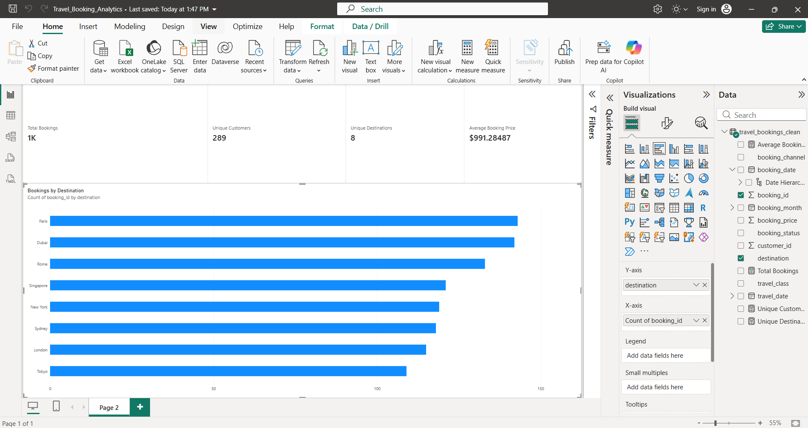

# Travel Booking Analytics

## Project Overview

This project explores travel booking data using Python, SQL, and Power BI. It demonstrates an end-to-end data analytics workflow, from data generation and validation to data cleaning, exploratory analysis, SQL querying, and dashboard development.

The project uses **1,000 synthetic travel booking records** to demonstrate how booking data can be prepared and analyzed to support business reporting.

## Objectives

- Inspect and validate booking data.
- Clean and prepare data for analysis.
- Explore booking patterns across destinations, channels, dates, and booking statuses.
- Use SQL to summarize booking activity.
- Build an interactive Power BI dashboard to communicate key performance indicators.

## Tools and Technologies

- **Python:** data generation, cleaning, analysis, and visualization
- **Pandas:** data manipulation
- **SQL / SQLite:** querying and aggregation
- **Power BI:** dashboard development
- **Git and GitHub:** version control and project documentation

## Project Workflow

1. Generate a synthetic travel booking dataset.
2. Inspect the dataset and validate its structure.
3. Clean and analyze the data using Python.
4. Create visualizations to explore booking patterns.
5. Load the cleaned data into SQLite and execute SQL queries.
6. Document findings and develop a Power BI dashboard.

## Repository Structure

- `data/` — raw and cleaned datasets and the SQLite database
- `images/` — Python-generated charts
- `reports/` — analytical findings and documentation
- `sql/` — SQL analysis queries
- `generate_data.py` — synthetic data generation
- `inspect_data.py` — data inspection and validation
- `clean_and_analyze.py` — cleaning, analysis, and visualization
- `load_data_to_sqlite.py` — database loading
- `summarize_findings.py` — findings summary generation
- `requirements.txt` — Python dependencies

## Analysis and Findings

See [`reports/analysis_findings.md`](reports/analysis_findings.md) for the Python analysis and [`reports/sql_analysis_findings.md`](reports/sql_analysis_findings.md) for the SQL analysis.

The findings should be interpreted as patterns within a synthetic dataset, not as evidence of real-world travel market behavior.

## How to Run

1. Clone this repository.
2. Create and activate a Python virtual environment.
3. Install dependencies:

   `pip install -r requirements.txt`

4. Run the scripts in the workflow order described above.
5. Open the SQL file in `sql/` to review the analysis queries.

Use the filenames in the repository as the source of truth for the exact execution order.

## Power BI Dashboard

## Limitations

The dataset is synthetic and was created for portfolio demonstration purposes. Results do not represent actual customer behavior, and booking prices should not be interpreted as verified business revenue.

## Future Improvements

- Complete and include the Power BI dashboard.
- Add a dashboard screenshot to the README.
- Expand the analysis with additional business KPIs.
- Improve documentation of the SQL results and business recommendations.

## Author

**Jyothi Pavan Kutala**

[GitHub Profile](https://github.com/Jyothipavan1229)
